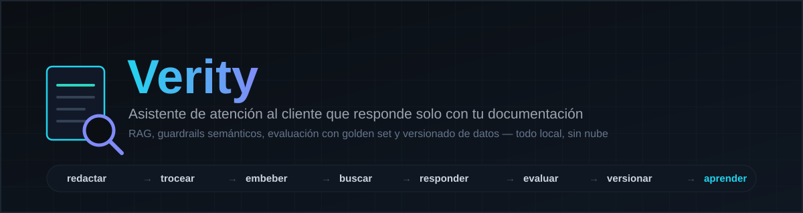
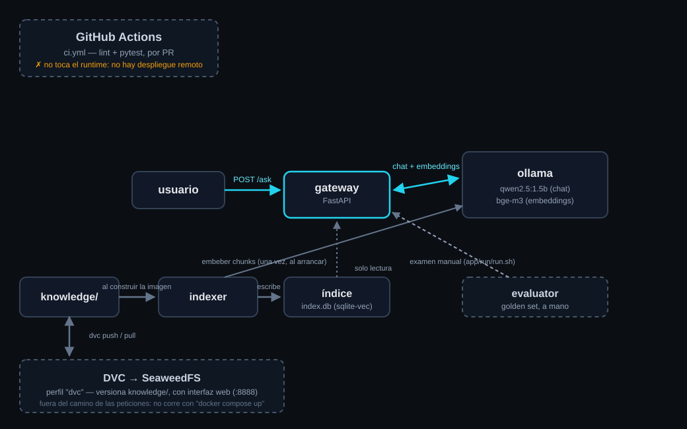

<div align="center">



<br>


**[Instalación](docs/es/install.md)** · **[Labs](#-labs)** · **[Break the Platform](docs/es/break.md)** · **[El stack](docs/es/stack.md)** · **[Arquitectura](docs/es/architecture.md)** · **[Referencias](docs/es/references.md)** · **[Toda la documentación](docs/es/README.md)**

[English](README.md) · **Español**

</div>

## ⚡ La idea

**Verity no es "otro chatbot": es un laboratorio de LLMOps que usa uno como excusa.** Lo construís,
lo evaluás con un golden set, lo versionás, lo rompés a propósito y lo entendés — llevando a la
práctica el ciclo completo: prompts versionados, RAG con umbral de confianza, guardrails semánticos,
evaluación repetible con puerta de calidad, y versionado de datos — **todo corriendo en tu propia
máquina, sin nube, sin tarjeta de crédito, sin cuentas que crear.**

> [!NOTE]
> Pensado para aprender leyendo código real, no solo documentación. Cada afirmación de este README
> apunta al archivo que la respalda.

## 🧱 Stack

**Aplicación**<br>
&nbsp;&nbsp;&nbsp;

**Datos**<br>
&nbsp;

**Plataforma**<br>
&nbsp;&nbsp;

**Calidad**<br>
&nbsp;&nbsp;&nbsp;&nbsp;

Por qué cada una y no otra: [docs/es/stack.md](docs/es/stack.md).

## 🏗 Arquitectura



GitHub Actions **nunca** toca el runtime: valida código en cada PR y listo. No hay pipeline de
despliegue porque no hay nube a la que desplegar — `docker compose up`, en tu máquina, **es** el
despliegue. Detalle caja por caja: [docs/es/architecture.md](docs/es/architecture.md).

## 🧪 Labs

| # | Lab | Aprendés |
| --- | --- | --- |
| 01 | [RAG](docs/es/labs/01-rag.md) | Troceo por secciones, embeddings, el umbral de confianza |
| 02 | [Guardrails](docs/es/labs/02-guardrails.md) | Enrutado semántico (saludo vs. pregunta real) sin modelo extra |
| 03 | [Docker](docs/es/labs/03-docker.md) | Servicios, perfiles, por qué `knowledge/` se hornea en la imagen |
| 04 | [DVC + SeaweedFS](docs/es/labs/04-dvc-seaweedfs.md) | Versionar documentos sin AWS, con interfaz web |
| 05 | [Evaluación](docs/es/labs/05-evaluation.md) | Golden set, puerta de calidad, `prompt_hash` y `release` |
| 06 | [GitHub Actions / CI](docs/es/labs/06-github-actions-ci.md) | Qué valida cada PR, y por qué no hay despliegue |

## 💥 Break the Platform

7 fallas reales, provocadas a propósito: **provocar → qué ves → dónde mirar → causa → arreglo →
lección.**

Gateway que no arranca sin claves · documento editado que el bot ignora · índice con el modelo de
embeddings equivocado · golden set vacío · bucket de SeaweedFS inexistente · rate limit · un secreto
opcional que por default no hace nada → [escenarios completos](docs/es/break.md)

## 🚀 Empezar

**Necesitás:** Docker (con Compose v2) y, si vas a usar DVC, [uv](https://docs.astral.sh/uv/). Nada
de nube, nada de cuentas.

```bash
git clone <tu-fork-o-el-repo> verity && cd verity
make local    # valida, construye, levanta — y te deja elegir qué hacer
```

<a href="docs/es/install.md"></a>
<a href="docs/es/README.md"></a>

<details>
<summary><b>Estructura del repositorio</b></summary>

```text
app/
├── gateway/        La API (FastAPI): auth, prompt, retrieval, guardrails, endpoints
├── rag/            Troceo de documentos + construcción e índice vectorial (sqlite-vec)
├── eval/           El examen: golden.jsonl, run_eval.py, el reporte
├── prompts/        system.md + template.md — versionados en git, con hash en cada respuesta
├── knowledge/       Tus documentos reales. Versionados con DVC (ver dvc-setup.sh)
├── docker/          Un Dockerfile por servicio que lo necesita (ver docker/README.md)
├── run/            run.sh (el único modo de correr el bot) · chat.sh
├── dvc-setup.sh     Bootstrap de un solo uso: SeaweedFS como remoto de DVC
└── docker-compose.yml

docs/
├── es/              Toda la documentación educativa en español
├── (sin sufijo)     La misma documentación en inglés (default)
└── images/          Diagramas y el banner de arriba

.github/workflows/   ci.yml — lint + pytest, por PR. Nada más
config.env           La configuración del bot: el único archivo que editás
```

</details>

---

<div align="center">

**[Toda la documentación →](docs/es/README.md)**

</div>
