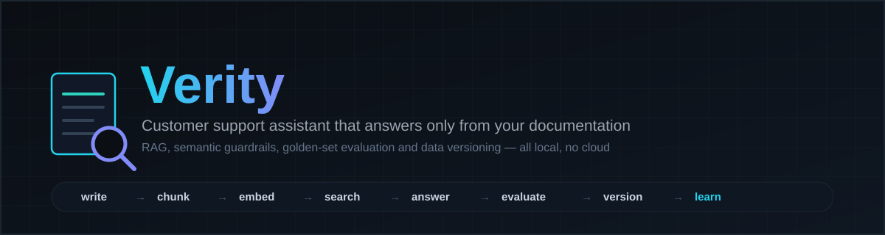
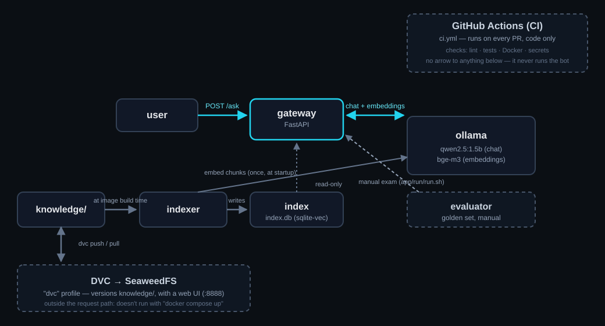

<div align="center">



<br>


**[Install](docs/install.md)** · **[Usage](docs/usage.md)** · **[Labs](#-labs)** · **[Break the Platform](docs/break.md)** · **[The stack](docs/stack.md)** · **[Architecture](docs/architecture.md)** · **[References](docs/references.md)** · **[Full documentation](docs/README.md)**

**English** · [Español](README.es.md)

</div>

## ⚡ The idea

**Verity isn't "just another chatbot": it's an LLMOps lab that uses one as an excuse.** You build it,
evaluate it with a golden set, version it, break it on purpose, and understand it — putting the full
cycle into practice: versioned prompts, RAG with a confidence threshold, semantic guardrails,
repeatable evaluation with a quality gate, and data versioning — **all running on your own machine,
no cloud, no credit card, no accounts to create.**

> [!NOTE]
> Built to be learned by reading real code, not just documentation. Every claim in this README
> points to the file that backs it up.

## 🧱 Stack

**Application**<br>
&nbsp;&nbsp;&nbsp;

**Data**<br>
&nbsp;

**Platform**<br>
&nbsp;&nbsp;

**Quality**<br>
&nbsp;&nbsp;&nbsp;&nbsp;

Why each one, and not another: [docs/stack.md](docs/stack.md).

## 🏗 Architecture



GitHub Actions **never** touches the runtime: it validates code on every PR, and that's it. There's
no deploy pipeline because there's no cloud to deploy to — `docker compose up`, on your machine,
**is** the deployment. Box-by-box detail: [docs/architecture.md](docs/architecture.md).

## 🧪 Labs

| # | Lab | You learn |
| --- | --- | --- |
| 01 | [RAG](docs/labs/01-rag.md) | Section-based chunking, embeddings, the confidence threshold |
| 02 | [Guardrails](docs/labs/02-guardrails.md) | Semantic routing (greeting vs. real question) without an extra model |
| 03 | [Docker](docs/labs/03-docker.md) | Services, profiles, why `knowledge/` gets baked into the image |
| 04 | [DVC + SeaweedFS](docs/labs/04-dvc-seaweedfs.md) | Versioning documents with a self-hosted, web-UI storage — no cloud account needed |
| 05 | [Evaluation](docs/labs/05-evaluation.md) | Golden set, quality gate, `prompt_hash` and `release` |
| 06 | [GitHub Actions / CI](docs/labs/06-github-actions-ci.md) | What every PR checks, and why there's no deploy |

## 💥 Break the Platform

7 real failures, provoked on purpose: **provoke → what you see → where to look → cause → fix →
lesson.**

A gateway that won't start without keys · an edited document the bot ignores · an index with the
wrong embedding model · an empty golden set · a missing SeaweedFS bucket · rate limiting · an
optional secret that by default does nothing → [full scenarios](docs/break.md)

## 🚀 Get started

**You need:** Docker (with Compose v2) and, if you'll use DVC, [uv](https://docs.astral.sh/uv/). No
cloud, no accounts.

```bash
git clone <your-fork-or-the-repo> verity && cd verity
make local    # validates, builds, brings it up — and lets you choose what to do
```

<a href="docs/install.md"></a>
<a href="docs/README.md"></a>

<details>
<summary><b>Repository structure</b></summary>

```text
app/
├── gateway/        The API (FastAPI): auth, prompt, retrieval, guardrails, endpoints
├── rag/            Document chunking + vector index building (sqlite-vec)
├── eval/           The exam: golden.jsonl, run_eval.py, the report
├── prompts/        system.md + template.md — versioned in git, hashed into every response
├── knowledge/       Your real documents. Versioned with DVC (see dvc-setup.sh)
├── docker/          One Dockerfile per service that needs one (see docker/README.md)
├── run/            run.sh (the one way to run the bot) · chat.sh
├── dvc-setup.sh     One-time bootstrap: SeaweedFS as the DVC remote
└── docker-compose.yml

docs/
├── (no suffix)      All the educational documentation, in English (default)
├── es/              The same documentation, in Spanish
└── images/          Diagrams and the banner above

.github/workflows/   ci.yml — lint + pytest, per PR. Nothing else
config.env           The bot's configuration: the only file you edit
```

</details>

---

<div align="center">

**[Full documentation →](docs/README.md)**

</div>
